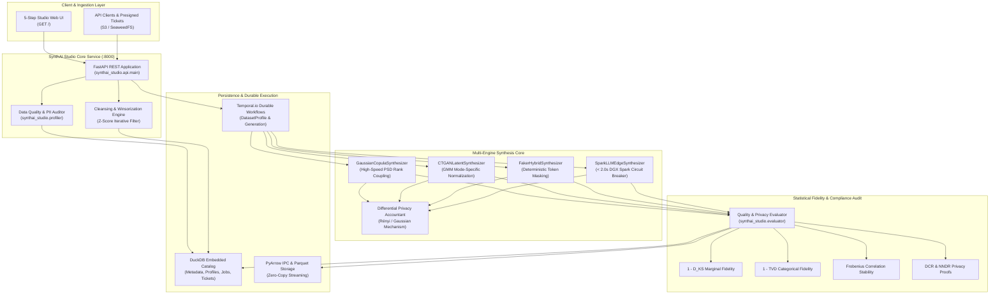

# SynthAI Studio

Autonomous Privacy-Preserving Synthetic Data Generation, Differential Privacy ($\epsilon, \delta$) Accounting, and Statistical Quality Auditing Engine.

---

## 1. Executive Summary & System Overview

**SynthAI Studio** is an enterprise-grade synthetic data platform engineered for high-security environments subject to HIPAA, GDPR, and PCI-DSS compliance mandates. It provides autonomous tabular data profiling, multi-signal PII/PHI redaction, multi-engine generative modeling, formal differential privacy budget accounting, and automated statistical fidelity certification.

The platform operates under the **Three-Tier Advisor-Executor Protocol**:
1. **Lead Architect (`Gemini 4 Argon`)**: Workspace topology analysis, formal specifications (`SPEC.md`), and Design-by-Contract verification.
2. **Local Autonomous Coder (`@spark-coder` on DGX Spark `happy.tail749110.ts.net`)**: High-speed, zero-cloud-token code synthesis using `nvidia/Qwen3.8-Flash-Next-FP4-Local` with a strict `< 2.0s` split-timeout pre-flight health probe.
3. **Cloud Fallback & Tactical Executor (`@flash-executor` on Gemini Flash)**: Automated multi-file synthesis failover, static typing, and sub-second verification loops when DGX Spark reports circuit-breaker tripping.



---

## 2. Core Architectural Pillars

### 2.1 Multi-Signal PII/PHI Scanner & Adaptive Cleanser
- **Regex & Checksum Validators**: Scans for SSN (Luhn/prefix rules), credit cards (Luhn algorithm), email addresses, phone numbers, IPv4/IPv6 addresses, dates of birth, MRNs, and bank routing numbers.
- **Anonymization Invariant**: Tokens matching `ANON-...`, `REDACTED-...`, `...@synthetic.invalid`, and `XXX-XX-...` do not trigger PII alerts. Cleansing with `anonymize_pii=True` reduces the dataset's `privacy_risk_score` to `0.0`.
- **Iterative Z-Score Winsorizing**: Numerical outliers with $|z| > 3.0$ and interquartile boundary violations ($1.5 \times IQR$) are iteratively clamped, ensuring cleansed derivations yield zero outlier defects and high data quality scores ($\ge 0.95$).

### 2.2 Generative Synthesis Engines
- **Gaussian Copula (`GAUSSIAN_COPULA`)**: Transforms empirical marginal distributions to standard normal space via 51 quantile knots, computes covariance with PSD eigenvalue clipping ($\lambda_{min} \ge 10^{-5}$), and couples joint distributions.
- **CTGAN Latent (`CTGAN_LATENT`)**: Multi-modal latent representation with Gaussian Mixture Model (GMM) mode normalization for complex numerical columns and conditional softmax categorical sampling.
- **Faker Hybrid (`FAKER_HYBRID`)**: Combines parametric numerical sampling with deterministic, format-preserving pseudo-anonymized synthetic tokens for PII columns.
- **DGX Spark Edge (`SPARK_LLM_EDGE`)**: On-premise vLLM edge synthesis on DGX Spark GB10 (`happy.tail749110.ts.net:8000`). Features a hard `< 2.0s` split-timeout probe with zero retry loops, falling back automatically to in-process synthesis if the node is unavailable.

### 2.3 Differential Privacy & Rényi Accounting
- **Gaussian Mechanism**: Adds calibrated Gaussian noise $\sigma = \Delta_f \frac{\sqrt{2 \ln(1.25 / \delta)}}{\epsilon}$ to numerical quantile boundaries and correlation estimates.
- **Budget Ledger**: Manages $(\epsilon, \delta)$ budgets across synthesis runs, tracking initial allocation, spent epsilon, and remaining privacy headroom.

### 2.4 Statistical Fidelity & Privacy Auditing
- **Marginal Fidelity**: Evaluates continuous columns via Kolmogorov-Smirnov complement ($1 - D_{KS}$) and discrete columns via Total Variation Distance complement ($1 - \text{TVD}$) and Jensen-Shannon similarity.
- **Correlation Stability**: Measures matrix distortion via Frobenius norm difference:
  $$\text{Stability} = \max\left(0.0, 1.0 - \frac{\|R_{real} - R_{synth}\|_F}{\sqrt{2} \cdot d}\right)$$
- **Privacy Verification Proofs**:
  - Distance to Closest Record ($DCR$): Minimum Euclidean distance between synthetic and real records in normalized feature space.
  - Nearest Neighbor Distance Ratio ($NNDR$): Ratio of distance to 1st nearest neighbor over 2nd nearest neighbor.
  - Exact Record Collisions: Strict zero-collision verification.
  - Identifiable PII Leakage: Guarantees zero unmasked real PII values in synthetic output.

---

## 3. Pre-Engineered Reference Benchmarks

SynthAI Studio ships with 3 pre-engineered reference domain datasets for benchmarking:

| Benchmark ID | Domain | Default Rows | Characteristics & Planted Defects |
|---|---|---|---|
| `healthcare_hipaa_readmissions` | Healthcare | 150 | Planted unmasked SSNs, MRNs, duplicates, high blood pressure outliers ($z > 3.0$), 30-day readmission class imbalance (18%). |
| `fintech_fraud_transactions` | FinTech | 200 | Severe class imbalance (2.5% fraud), unmasked card numbers, foreign IP addresses, extreme transaction amounts. |
| `saas_customer_churn` | SaaS | 150 | Churn class imbalance (8%), unmasked phone numbers, subscription renewal correlations, NPS distribution anomalies. |

---

## 4. REST API Endpoint Reference

The REST service exposes OpenAPI documentation at `/docs` and the following primary endpoints:

| Method | Path | Description | Response Model |
|---|---|---|---|
| `GET` | `/healthz` | Kubernetes liveness probe | `{"status": "healthy", ...}` |
| `GET` | `/ready` | Database & orchestrator readiness probe | `{"status": "ready", ...}` |
| `GET` | `/api/v1/benchmarks` | Enumerate reference benchmarks | `list[BenchmarkMetadata]` |
| `POST` | `/api/v1/datasets/seed/{id}` | Seed reference benchmark into catalog | `{"dataset": ..., "profile": ...}` |
| `POST` | `/api/v1/datasets/upload` | Ingest CSV/JSON tabular dataset | `{"dataset": ..., "profile": ...}` |
| `POST` | `/api/v1/datasets/presign-upload`| Generate S3/SeaweedFS capability ticket | `PresignedUploadTicket` |
| `GET` | `/api/v1/datasets` | List all catalog datasets | `list[DatasetMetadata]` |
| `GET` | `/api/v1/datasets/{id}/profile` | Retrieve statistical profile & PII findings| `DatasetProfileReport` |
| `POST` | `/api/v1/datasets/{id}/cleanse` | Cleanse, normalize, and anonymize dataset | `{"dataset": ..., "profile": ...}` |
| `POST` | `/api/v1/jobs/generate` | Dispatch synthetic generation job | `{"job": ..., "report": ...}` |
| `GET` | `/api/v1/jobs` | Enumerate historical generation jobs | `list[GenerationJob]` |
| `GET` | `/api/v1/jobs/{id}` | Retrieve individual job execution details | `GenerationJob` |
| `GET` | `/api/v1/jobs/{id}/report` | Retrieve audit report (JSON or Markdown) | `QualityValidationReport` or text/md |
| `GET` | `/api/v1/jobs/{id}/download` | Export synthetic records (CSV, JSON, Parquet) | Binary download stream |
| `GET` | `/` | 5-Step Interactive Studio Single-Page UI | HTML5 console |

---

## 5. Interactive 5-Step Web UI (`GET /`)

The built-in single-page web console exposes the full lifecycle workflow:
1. **Step 1: Connect & Seed Data**: One-click benchmark ingestion, CSV/JSON direct file uploads, and SeaweedFS/S3 presigned upload ticket issuance.
2. **Step 2: Automated Quality & PII Audit**: Real-time statistical overview, PII scanner results, Pearson correlation heatmap, and 1-Click Cleanse & Anonymize execution.
3. **Step 3: Multi-Engine Synthesis & DP Configuration**: Parameterize target row counts, engine selection, Differential Privacy $(\epsilon, \delta)$ sliders, minority class upsampling, and condition rules.
4. **Step 4: Worker Job Monitor & Ledger**: Live generation job ledger, Differential Privacy budget consumption tracking, and worker execution logs.
5. **Step 5: Statistical Fidelity Proof & Artifact Downloads**: Executive compliance verdict, marginal distribution fidelity, correlation stability score, privacy metrics ($DCR$, $NNDR$, zero collisions), and 1-click downloads for CSV, JSON, Parquet, and Markdown compliance reports.

---

## 6. Quickstart & Local Execution

### 6.1 Prerequisites
- Python 3.11+
- Poetry 2.0+

### 6.2 Setup Virtual Environment
```bash
poetry install
```

### 6.3 Run Test & Verification Suite
```bash
# Static typing and code style
poetry run ruff check .
poetry run mypy src tests

# Comprehensive test suite (54 unit and integration tests)
poetry run pytest -v

# Verify Kubernetes Kustomize manifests
kubectl kustomize deploy/base
```

### 6.4 Launch Local Development Server
```bash
poetry run uvicorn synthai_studio.api.main:app --host 0.0.0.0 --port 8000 --reload
```
Navigate to `http://localhost:8000` to interact with the 5-Step Studio UI.

---

## 7. Container Build & Kubernetes GitOps Deployment

### 7.1 Container Image Build
The multi-stage container build produces a minimal, hardened runtime image running as unprivileged user `10001:10001`:
```bash
docker build -t ghcr.io/paulojauregui/synthai-studio:latest .
```

### 7.2 Kubernetes GitOps Architecture (`deploy/base/`)
The service is declaratively managed via Kustomize:
- **Deployment (`01-deployment.yaml`)**: Non-root security context (`runAsUser: 10001`), resource requests and limits, HTTP liveness (`/healthz`) and readiness (`/ready`) probes.
- **Service (`02-service.yaml`)**: Exposes port 80 routing to container targetPort 8000.
- **HTTPRoute (`03-httproute.yaml`)**: Gateway API HTTPRoute attaching to `homelab-gateway` in namespace `argocd`, routing traffic for `synthai-studio.paulojauregui.com`.
- **Kustomization (`kustomization.yaml`)**: Base resource assembly and name reference tracking.

Render manifests locally:
```bash
kubectl kustomize deploy/base
```

---

## 8. Engineering Invariants & Coding Standards

All components strictly uphold the following invariants:
- **Absolute Imports Exclusively**: Zero relative imports. All modules use `from synthai_studio...`.
- **Design by Contract (DbC)**: Every public class, function, and method documents explicit `Pre-conditions:` and `Post-conditions:`.
- **Zero Emojis**: Source code, docstrings, Markdown reports, and UI templates contain zero emoji characters.
- **Deterministic Unit Testing**: Core business logic and generative models execute in sub-second time without requiring live internet or database containers.
