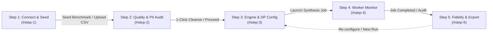

# SynthAI Studio — Principal UI/UX & Interaction Architecture Specification (`v2-ux`)

**Status:** Approved Gate 1 Contract  
**Author:** Principal UI/UX & Interaction Architect (`@ux-architect`)  
**Service:** `synthai-studio` (`GET /` Interactive 5-Step Workbench & FastAPI Control Plane)  
**Accessibility Standard:** WCAG 2.2 Level AA  

---

## 1. Operator Personas & Core Journeys

SynthAI Studio serves two distinct technical personas operating inside enterprise data engineering and regulated privacy compliance environments. Every screen, control, and telemetry indicator maps directly to a concrete Job-To-Be-Done (JTBD).

### 1.1 Persona A — ML Data & Platform Engineer
* **Context**: Builds training, evaluation, and CI test datasets for machine learning pipelines where production data is class-imbalanced, restricted, or expensive to sample at scale.
* **Primary Jobs-To-Be-Done (JTBD)**:
  1. **Seed Reference Domain Benchmarks**: Rapidly provision realistic baseline datasets (`healthcare_hipaa_readmissions`, `fintech_fraud_transactions`, `saas_customer_churn`) with known minority label imbalances (`target_column`, `minority_label`) and planted PII columns (`pii_columns`).
  2. **Ingest Custom Tabular Datasets & Issue Storage Capability Tickets**: Upload custom CSV/JSON files via multipart form or JSON payloads, or mint short-lived single-use S3/SeaweedFS presigned upload capability tickets (`upload_token`, `upload_url`, `expires_at`, `max_bytes`).
  3. **Configure Multi-Engine Generative Synthesis & Class Rebalancing**: Select the optimal generative engine (`GAUSSIAN_COPULA`, `CTGAN_LATENT`, `FAKER_HYBRID`, or `SPARK_LLM_EDGE`), configure minority class upsampling via `upsample_config` (`column`, `minority_value`, `target_ratio`), and set deterministic PRNG seeds (`random_seed`).
  4. **Verify Compute Tier Provenance & Worker Execution**: Monitor job execution status (`PENDING`, `RUNNING`, `COMPLETED`, `FAILED`), throughput (`throughput_rows_per_sec`), and compute tier provenance (`ComputeTier.GPU_SPARK_WORKER` vs. `ComputeTier.CPU_WORKER`), immediately identifying when the `< 2.0s` DGX Spark circuit breaker trips and falls back to local CPU Gaussian Copula execution.
  5. **Inspect Column-Level Statistical Fidelity & Export Artifacts**: Evaluate column-by-column distribution fidelity (`1 - KS` for numerical/datetime columns, `1 - TVD` for categorical/boolean columns, `jensen_shannon_similarity`) and export synthetic datasets in `.csv`, `.json`, or `.parquet` formats.

### 1.2 Persona B — Privacy & Compliance Auditor (HIPAA / GDPR)
* **Context**: Audits datasets and synthetic data pipelines before authorizing data release across trust boundaries, ensuring zero unmasked PII/PHI leakage and verifiable mathematical privacy guarantees.
* **Primary Jobs-To-Be-Done (JTBD)**:
  1. **Audit Raw Datasets for Unmasked PII/PHI & Quality Defects**: Inspect automated column scans across 7 PII/PHI categories (`EMAIL`, `SSN`, `PHONE`, `CREDIT_CARD`, `MEDICAL_RECORD_NUMBER`, `PERSON_NAME`, `IP_ADDRESS`) alongside detection confidence (`confidence`), sample matches (`sample_match_count`), detection rationale (`detection_reason`), remediation guidance (`remediation`), and structural data quality defects (`MISSING_VALUES`, `DUPLICATE_ROWS`, `NUMERICAL_OUTLIERS`, `INCONSISTENT_FORMATTING`, `UNMASKED_PII`).
  2. **Execute 1-Click Cleanse & Anonymize**: Trigger deterministic deduplication, missing-value imputation, outlier Winsorization, and format-preserving synthetic token replacement (`POST /api/v1/datasets/{dataset_id}/cleanse`) to reduce `privacy_risk_score` to `0.0`.
  3. **Enforce Formal $(\epsilon, \delta)$-Differential Privacy Budgets**: Configure privacy enforcement tiers (`HIGH` at $\epsilon=0.1, \delta=10^{-6}$; `MEDIUM` at $\epsilon=1.0, \delta=10^{-5}$; `LOW` at $\epsilon=10.0, \delta=10^{-5}$; `NONE`) and verify that PII anonymization (`anonymize_pii`) is active.
  4. **Audit the Privacy Budget Ledger**: Inspect the immutable `PrivacyBudgetLedger` emitted per job: `privacy_level`, `epsilon_spent`, `delta`, `mechanism` (`Laplace+Gaussian-Analytic` vs. `None (Unperturbed Empirical)`), calibrated Laplace/Gaussian `noise_scale`, and positive semi-definite correlation matrix projection (`psd_projection_applied`).
  5. **Verify Empirical Privacy Attack Surface Proofs & Sign Off**: Validate empirical privacy metrics (`exact_match_collision_rate`, `dcr_median`, `dcr_p05`, `nndr_median`, `nndr_p05`, `privacy_protection_score`, `pii_leakage_detected`), confirm `hipaa_gdpr_ready` certification status, and download the signed Markdown Compliance Audit Report (`.md`).

### 1.3 End-to-End Operator Workflow Topology



---

## 2. Semantic Landmarks & Keyboard-First Navigation Contract (WCAG 2.2 AA)

### 2.1 Document Landmarks & Backward-Compatibility Invariants
To satisfy both WCAG 2.2 AA structural navigation and existing integration test contracts (`tests/test_api.py::test_interactive_web_ui_endpoint`), `GET /` MUST preserve the uppercase substrings `"SYNTHAI STUDIO"`, `"DIFFERENTIAL PRIVACY"`, and section IDs `"step-1"`, `"step-2"`, `"step-3"`, `"step-4"`, `"step-5"` while upgrading the DOM to strict semantic HTML5 landmarks:

1. **Skip Navigation Link**:
   * First focusable child of `<body>`:
     ```html
     <a href="#main-workbench" class="skip-link">Skip to main workbench</a>
     ```
   * Visually hidden off-screen by default; slides into the top-left viewport (`z-index: 1000`) with a high-contrast `2px solid var(--accent-cyan)` focus ring on `:focus-visible`.
2. **Banner Landmark (`<header role="banner">`)**:
   * Contains the application brand identity (`SYNTHAI STUDIO // AUTONOMOUS PRIVACY & FIDELITY ENGINE`), operational subtitle (`DIFFERENTIAL PRIVACY (ε,δ) • GENERATIVE MODELS • HIPAA/GDPR`), and live cluster telemetry status pills (`#status-service`, `#status-catalog`, `#status-temporal`).
3. **Primary Workflow Navigation Landmark (`<nav aria-label="SynthAI Studio Workflow Steps">`)**:
   * Wraps `<div role="tablist" aria-label="5-Step Synthesis Pipeline" id="workflow-tablist">`.
   * Contains five semantic `<button type="button" role="tab">` elements instead of non-focusable `<div>` tags:

| Step | Tab Button ID | `aria-controls` | `data-step` | Default `aria-selected` | Default `tabindex` | Visible Label |
| :--- | :--- | :--- | :--- | :--- | :--- | :--- |
| **1** | `tab-step-1` | `step-1` | `"1"` | `"true"` | `"0"` | `1. Connect & Seed` |
| **2** | `tab-step-2` | `step-2` | `"2"` | `"false"` | `"-1"` | `2. Quality & PII Audit` |
| **3** | `tab-step-3` | `step-3` | `"3"` | `"false"` | `"-1"` | `3. Engine & DP Config` |
| **4** | `tab-step-4` | `step-4` | `"4"` | `"false"` | `"-1"` | `4. Worker Monitor` |
| **5** | `tab-step-5` | `step-5` | `"5"` | `"false"` | `"-1"` | `5. Fidelity & Export` |

4. **Main Workbench Landmark (`<main id="main-workbench" tabindex="-1">`)**:
   * Contains the global actionable error alert container (`#global-error-banner`) and the five workflow step panels:
     * `<section id="step-1" class="step-panel active" role="tabpanel" aria-labelledby="tab-step-1">`
     * `<section id="step-2" class="step-panel" role="tabpanel" aria-labelledby="tab-step-2" hidden>`
     * `<section id="step-3" class="step-panel" role="tabpanel" aria-labelledby="tab-step-3" hidden>`
     * `<section id="step-4" class="step-panel" role="tabpanel" aria-labelledby="tab-step-4" hidden>`
     * `<section id="step-5" class="step-panel" role="tabpanel" aria-labelledby="tab-step-5" hidden>`
   * When switching to step $k \in \{1..5\}$ via `switchStep(k)`:
     * For the active panel ($i = k$): add class `.active`, remove the `hidden` attribute, set `aria-selected="true"` and `tabindex="0"` on `#tab-step-k`.
     * For inactive panels ($i \neq k$): remove class `.active`, set the `hidden` attribute, set `aria-selected="false"` and `tabindex="-1"` on `#tab-step-i`.

### 2.2 Roving `tabindex` & Keyboard Shortcut Controller
The `#workflow-tablist` container implements the WAI-ARIA Authoring Practices 1.2 Tabs Pattern with roving `tabindex`:
* **`ArrowRight` / `ArrowDown`**: Moves focus to the next tab in sequence (wrapping from Step 5 to Step 1) and activates that step immediately.
* **`ArrowLeft` / `ArrowUp`**: Moves focus to the previous tab in sequence (wrapping from Step 1 to Step 5) and activates that step immediately.
* **`Home`**: Moves focus to `#tab-step-1` and activates Step 1.
* **`End`**: Moves focus to `#tab-step-5` and activates Step 5.
* **`Enter` / `Space`**: Activates the focused tab if not already active.
* **`Escape`**: Dismisses `#global-error-banner` (if visible) and returns keyboard focus to the active step's tab button.

### 2.3 Explicit Form Label & Control Accessibility Contracts
Every `<input>` and `<select>` across all 5 steps MUST have an explicit `<label for="...">` binding and descriptive helper or constraint attributes. No orphan labels are permitted.

| Step | Control ID | Element Type | Explicit `<label for="...">` Text | Constraints / Default Attributes |
| :--- | :--- | :--- | :--- | :--- |
| **1** | `upload-name` | `<input type="text">` | `Dataset Name` | `required`, `placeholder="my_enterprise_dataset"`, `autocomplete="off"` |
| **1** | `upload-file` | `<input type="file">` | `Upload CSV or JSON File` | `required`, `accept=".csv,.json"` |
| **1** | `presign-name` | `<input type="text">` | `Target Dataset Name for Capability Ticket` | `placeholder="seaweedfs_target_dataset"`, `autocomplete="off"` |
| **2** | `profile-dataset-select` | `<select>` | `Inspected Dataset` | Populated from `GET /api/v1/datasets` |
| **3** | `gen-dataset-id` | `<select>` | `Target Dataset` | `required`, populated from `GET /api/v1/datasets` |
| **3** | `gen-target-rows` | `<input type="number">` | `Target Row Count (10 - 200,000)` | `required`, `value="250"`, `min="10"`, `max="200000"`, `step="10"` |
| **3** | `gen-engine` | `<select>` | `Synthesizer Engine` | Options: `GAUSSIAN_COPULA`, `CTGAN_LATENT`, `FAKER_HYBRID`, `SPARK_LLM_EDGE` |
| **3** | `gen-privacy-level` | `<select>` | `Differential Privacy Tier` | Options: `MEDIUM`, `LOW`, `HIGH`, `NONE` |
| **3** | `gen-epsilon` | `<input type="number">` | `Epsilon (ε) Privacy Budget` | `value="1.0"`, `min="0.01"`, `max="100.0"`, `step="0.05"` (disabled when `privacy_level == "NONE"`) |
| **3** | `gen-delta` | `<input type="number">` | `Delta (δ) Failure Probability` | `value="0.00001"`, `min="0.0000001"`, `max="0.1"`, `step="0.000001"` (disabled when `privacy_level == "NONE"`) |
| **3** | `gen-target-col` | `<input type="text">` | `Minority Upsampling Target Column (Optional)` | `placeholder="readmitted_30d / is_fraud / churned"` |
| **3** | `gen-minority-val` | `<input type="text">` | `Minority Class Value (Optional)` | `placeholder="1 / true / yes"`, parsed to `int`/`bool`/`str` |
| **3** | `gen-minority-ratio` | `<input type="number">` | `Target Minority Ratio (0.05 - 0.95)` | `value="0.30"`, `min="0.05"`, `max="0.95"`, `step="0.05"` |
| **3** | `gen-anonymize-pii` | `<input type="checkbox">` | `Anonymize PII identifiers with synthetic format-preserving tokens` | `checked` by default |
| **5** | `report-job-select` | `<select>` | `Audited Generation Job` | Populated from `GET /api/v1/jobs` |

### 2.4 Error Summary Focus Management
* `#global-error-banner` (`role="alert"`, `tabindex="-1"`, `hidden` by default) sits at the top of `<main id="main-workbench">`.
* Whenever a form validation error or HTTP API error (`4xx`/`5xx` or network exception) occurs:
  1. `#global-error-banner` is unhidden and populated with the structured error title, human-readable message, and a `[Dismiss Error]` button (`#global-error-dismiss`) plus context-specific recovery CTA.
  2. Focus is moved programmatically (`document.getElementById('global-error-banner').focus()`) so keyboard and screen-reader users are immediately positioned at the recovery action.

---

## 3. ARIA Live Status Regions

Two dedicated off-screen live announcer regions (`class="sr-only"`) MUST be rendered inside `<body>` to broadcast asynchronous state transitions without stealing keyboard focus during nominal operations:

1. **Polite Operational Announcer (`#aria-status-polite`)**:
   ```html
   <div id="aria-status-polite" class="sr-only" role="status" aria-live="polite" aria-atomic="true"></div>
   ```
   * **Announced Events**:
     * Workflow step navigation: `"Activated Step {k}: {Step Title}."`
     * Benchmark seeding completion: `"Seeded benchmark {name} with {row_count} rows. Navigated to Step 2: Quality and PII Audit."`
     * Custom dataset upload completion: `"Uploaded and profiled dataset {name} ({row_count} rows)."`
     * Presigned capability ticket issuance: `"Generated presigned upload ticket for {dataset_name}."`
     * 1-Click Cleanse & Anonymize completion: `"Cleansed dataset {name}. Privacy risk score reduced to {privacy_risk_score}%."`
     * Synthetic generation job completion: `"Generation job {job_id} completed on {compute_tier}. Overall quality score: {overall_quality_score}%."`
2. **Assertive Alert Announcer (`#aria-status-assertive`)**:
   ```html
   <div id="aria-status-assertive" class="sr-only" role="alert" aria-live="assertive" aria-atomic="true"></div>
   ```
   * **Announced Events**:
     * Degraded compute fallback: `"Notice: DGX Spark edge endpoint unavailable under 2.0 second circuit breaker. Job {job_id} executed on local CPU worker fallback."`
     * Form validation failures or API errors: `"Error: {error_detail}"`

---

## 4. 5-State Component Matrix Across All 5 Workflow Steps

Every interactive container across Steps 1–5 MUST deterministically transition through five explicit visual and semantic states using standardized state classes: `.state-empty`, `.state-loading`, `.state-nominal`, `.state-degraded`, and `.state-error`.

### 4.1 Global State Class Invariants
* **`.state-empty`**: Displayed when a collection, selector, or report has zero records. Never renders a blank container or raw `"undefined"`. Always includes a clear explanation and a 1-click primary CTA button to populate or navigate to the prerequisite step.
* **`.state-loading`**: Displayed while an asynchronous `fetch()` is in flight. Sets `aria-busy="true"` on the container and renders geometry-matched skeleton blocks (`.skeleton`, `.skeleton-tile`, `.skeleton-row`) with identical heights and grid spans as the nominal view to guarantee zero Cumulative Layout Shift (`CLS = 0`).
* **`.state-nominal`**: High-density, scannable tabular and metric presentation using `font-variant-numeric: tabular-nums` on all numeric cells and `<th scope="col">` / `<th scope="row">` on all tables.
* **`.state-degraded`**: Explicit amber provenance indicator when an upstream dependency operates in fallback mode (e.g., `SPARK_LLM_EDGE` falling back to `ComputeTier.CPU_WORKER`, or Temporal running in local in-process worker mode).
* **`.state-error`**: Structured rose alert banner displaying the HTTP status or validation fault, root cause explanation, and a 1-click `[Retry]` or `[Reset]` action button.

### 4.2 Step-by-Step 5-State Matrix

| Workflow Step & Container | State 1: `Empty` (`.state-empty`) | State 2: `Loading` (`.state-loading`, `CLS = 0`) | State 3: `Nominal` (`.state-nominal`) | State 4: `Degraded / Offline Fallback` (`.state-degraded`) | State 5: `Error` (`.state-error`) |
| :--- | :--- | :--- | :--- | :--- | :--- |
| **Step 1: Connect & Seed**<br/>`#benchmark-cards`<br/>`#upload-form`<br/>`#presign-result` | If `/api/v1/benchmarks` returns `[]`, renders empty state panel with `[Retry Benchmark Discovery]` button. `#presign-result` remains hidden until a ticket is requested. | `aria-busy="true"` on `#benchmark-cards`; renders 3 geometry-matched `.skeleton-card` blocks (`height: 136px` each) matching the 3 domain benchmarks. Upload/Seed buttons show spinner text and `disabled` attribute during POST. | Renders the 3 domain benchmark cards (`healthcare_hipaa_readmissions`, `fintech_fraud_transactions`, `saas_customer_churn`) displaying `domain`, `default_row_count`, `target_column` (`minority_label`), `pii_columns` badges, `highlights` pills, and `[Seed Benchmark Dataset]` CTA. `#presign-result` displays `upload_token`, `upload_url`, `expires_at`, and `max_bytes`. | When `/ready` reports `temporal_host == null`, `#status-temporal` renders `TEMPORAL: LOCAL FALLBACK` with `.badge-warn` styling, informing the operator that jobs run via the in-process worker loop. | Invalid CSV/JSON upload or expired presigned token triggers `#global-error-banner` and inline `.state-error` card with `[Reset Upload Form]` CTA. |
| **Step 2: Quality & PII Audit**<br/>`#step-2`<br/>`#profile-columns-table`<br/>`#profile-issues-list`<br/>`#profile-corr-table` | When no dataset is available in catalog, renders `#profile-empty-state` with explanation and 1-click `[Seed Healthcare HIPAA Benchmark]` + `[Go to Step 1: Connect & Seed]` buttons. | `aria-busy="true"` on `#step-2`; 4 stat tiles show `.skeleton-tile` bars; `#profile-columns-table` renders 6 `.skeleton-row` rows (`height: 37px` each) so table height does not jump on load. | Displays 4 summary tiles (`row_count`, `column_count`, `data_quality_score`, `privacy_risk_score`), cleansed status badge (`is_cleansed`), Column Profiles & PII Scan table (joining `columns[]` with `pii_findings[]` to show `name`, `inferred_type`, `pii_type`, `confidence`, `remediation`, `null_count`, `outlier_count_zscore`), Data Quality Defects list (`quality_issues[]`), and Pearson Correlation Heatmap (`correlation_columns`, `correlation_matrix`). | If dataset has zero numeric columns (`correlation_columns.length === 0`), `#profile-corr-table` renders a `.state-degraded` notice explaining that Pearson rank correlation requires $\ge 1$ numerical column while preserving full nominal rendering for categorical columns. | If `GET /api/v1/datasets/{id}/profile` or `POST /cleanse` fails, renders `.state-error` row in `#profile-columns-table` with `[Retry Profile Load]` button. |
| **Step 3: Engine & DP Config**<br/>`#synth-config-form` | If catalog has zero datasets, disables submit button and displays inline `.state-empty` callout with `[Seed Reference Dataset First]` button. | While `POST /api/v1/jobs/generate` is executing, sets `aria-busy="true"` on `#synth-config-form`, disables `#btn-launch-synth`, and updates button label to `Executing Synthesis & Auditing...`. | Interactive 2-column configuration form with live DP parameter sync (`updateDpDefaults()`), auto-populated `gen-target-col` and `gen-minority-val` when selecting a seeded benchmark dataset, and explicit DP guarantee preview callout (`#dp-guarantee-preview`). | Selecting `privacy_level == "NONE"` switches `#dp-guarantee-preview` to `.state-degraded` (`UNPERTURBED EMPIRICAL MODE: Formal (ε,δ)-DP noise injection is disabled; HIPAA/GDPR certification requires LOW, MEDIUM, or HIGH`). Selecting `SPARK_LLM_EDGE` displays circuit-breaker notice (`< 2.0s probe to happy.tail749110.ts.net:8000 with automatic CPU Copula fallback`). | Out-of-bounds inputs (`target_rows < 10`, invalid `epsilon`) or `POST /api/v1/jobs/generate` HTTP errors surface in `#global-error-banner` with `[Reset to Recommended Defaults]`. |
| **Step 4: Worker Monitor**<br/>`#jobs-table`<br/>`#privacy-ledger-card`<br/>`#compute-fallback-banner` | When `jobs.length === 0`, `#jobs-table tbody` renders `.state-empty` with message `"No synthetic generation jobs executed yet"` and 1-click `[Configure & Launch Job in Step 3]` CTA button. | `aria-busy="true"` on `#jobs-table`; renders 3 `.skeleton-row` placeholders during job list refresh or active job execution. | Renders `#jobs-table` with columns: `Job ID`, `Dataset`, `Engine`, `Compute Tier` (`compute_tier`), `Status` (`status`), `Rows & Throughput` (`rows_generated`, `throughput_rows_per_sec`), and `[Audit Report]` action button. Renders `#privacy-ledger-card` with exact `PrivacyBudgetLedger` fields (`epsilon_spent`, `delta`, `privacy_level`, `mechanism`, `noise_scale`, `psd_projection_applied`). | **Degraded Compute Provenance (`#compute-fallback-banner`)**: Whenever the selected or latest job has `config.engine === "SPARK_LLM_EDGE"` and `compute_tier === "CPU_WORKER"`, unhides `#compute-fallback-banner` (`.state-degraded`) in Step 4 explaining that the `< 2.0s` DGX Spark circuit breaker tripped and cleanly failed over to local `CPU_WORKER` Gaussian Copula execution without data loss. | If a job has `status === "FAILED"` or `error_message !== null`, highlights the row with `.badge-danger`, displays `error_message`, and provides `[Re-Configure in Step 3]` button. |
| **Step 5: Fidelity & Export**<br/>`#step-5`<br/>`#fidelity-columns-table`<br/>`#compute-fallback-banner-step5` | When no job is selected or available, renders `#report-empty-state` (`.state-empty`) with `[Go to Step 3: Launch Synthesis Job]`. | `aria-busy="true"` on `#step-5`; 4 top score tiles render `.skeleton-tile` placeholders and `#fidelity-columns-table` renders 6 `.skeleton-row` placeholders while `GET /api/v1/jobs/{id}/report` is loading. | Displays 4 aggregate score tiles (`overall_quality_score`, `marginal_fidelity_score`, `correlation_stability_score`, `privacy_score`), Executive Compliance Verdict (`executive_verdict`, `hipaa_gdpr_ready`), Privacy Attack Surface proof metrics (`dcr_median`, `dcr_p05`, `nndr_median`, `nndr_p05`, `exact_match_collision_rate`, `pii_leakage_detected`), Column-Level Fidelity table (`column_metrics[]`: `column_name`, `column_type`, `metric_name`, `score`, `statistic_distance`, `jensen_shannon_similarity`), and 1-click export buttons (`.csv`, `.json`, `.parquet`, `.md`). | Displays `#compute-fallback-banner-step5` (`.state-degraded`) when `report.engine === "SPARK_LLM_EDGE"` and the corresponding job executed on `ComputeTier.CPU_WORKER`, or when `report.hipaa_gdpr_ready === false` (warning the auditor why compliance certification was withheld, e.g., `privacy_level === "NONE"` or PII leakage). | If report retrieval or artifact download fails, displays `.state-error` banner with `[Retry Report Fetch]` CTA. |

---

## 5. Canonical DOM ID & API Field Mapping Contract

To eliminate any discrepancy between frontend JavaScript rendering and backend Pydantic v2 serialization in [`src/synthai_studio/models.py`](file:///home/tron/workspace/synthai-studio/src/synthai_studio/models.py), `@spark-coder` MUST bind the exact DOM IDs below to the exact JSON field names returned by the FastAPI endpoints.

### 5.1 Header & Global Status DOM Contract (`GET /ready`)

| DOM ID | HTML Element | Source Endpoint | Exact JSON Field Path & Formatting Rule |
| :--- | :--- | :--- | :--- |
| `status-service` | `<span class="badge">` | `GET /healthz` or `GET /ready` | `"SERVICE: ONLINE"` (`.badge-success`) when `status === "ready"`, else `"SERVICE: DEGRADED"` (`.badge-danger`) |
| `status-catalog` | `<span class="badge">` | `GET /ready` | `` `DATASETS: ${ready.datasets_count}` `` (`.badge-info`) |
| `status-temporal` | `<span class="badge">` | `GET /ready` | If `ready.temporal_host` is truthy: `"TEMPORAL: READY"` (`.badge-success`); if `null`: `"TEMPORAL: LOCAL WORKER"` (`.badge-warn`) |
| `global-error-banner` | `<div role="alert" tabindex="-1">` | Client / API Error Handler | Hidden by default (`hidden`); displays `#global-error-text` and `#global-error-dismiss` button on any error |
| `aria-status-polite` | `<div role="status" aria-live="polite">` | Client State Controller | Screen-reader polite status text updates |
| `aria-status-assertive` | `<div role="alert" aria-live="assertive">` | Client Error / Fallback Controller | Screen-reader assertive alert text updates |

### 5.2 Step 1 (`#step-1`) — Benchmarks, Upload & Presigned Tickets

| DOM ID | HTML Element | Source Endpoint | Exact JSON Field Path (`BenchmarkMetadata` / `PresignedUploadTicket`) |
| :--- | :--- | :--- | :--- |
| `benchmark-cards` | `<div>` | `GET /api/v1/benchmarks` | Array of `BenchmarkMetadata`: `b.benchmark_id`, `b.name`, `b.domain`, `b.description`, `b.default_row_count`, `b.target_column`, `b.minority_label`, `b.pii_columns` (`list[str]`), `b.highlights` (`list[str]`). **Note:** Never reference `b.planted_defects` (non-existent field); use `b.pii_columns` and `b.highlights`. |
| `upload-form` | `<form>` | `POST /api/v1/datasets/upload` | Multipart form fields: `name` (`#upload-name`), `file` (`#upload-file`). Response: `{ dataset: DatasetMetadata, profile: DatasetProfileReport }`. |
| `presign-name` | `<input type="text">` | `POST /api/v1/datasets/presign-upload` | Request body: `{ dataset_name: string, expiry_seconds: 3600 }`. |
| `presign-result` | `<div>` | `POST /api/v1/datasets/presign-upload` | Container toggled visible when `PresignedUploadTicket` is returned. |
| `presign-text` | `<pre>` | `POST /api/v1/datasets/presign-upload` | Displays `ticket.upload_token`, `ticket.dataset_name`, `ticket.upload_url`, `ticket.expires_at`, `ticket.max_bytes`. |

### 5.3 Step 2 (`#step-2`) — Dataset Profiling, PII Findings & Quality Audit

| DOM ID | HTML Element | Source Endpoint | Exact JSON Field Path (`DatasetProfileReport`, `ColumnProfile`, `PIIFinding`, `DataQualityIssue`) |
| :--- | :--- | :--- | :--- |
| `profile-dataset-select` | `<select>` | `GET /api/v1/datasets` | Options bound to `d.dataset_id` with label `${d.name} (${d.row_count} rows)${d.is_cleansed ? ' [CLEANSED]' : ''}`. |
| `btn-cleanse-dataset` | `<button type="button">` | `POST /api/v1/datasets/{dataset_id}/cleanse` | Request body: `{ anonymize_pii: true }`. Response: `{ dataset: DatasetMetadata, profile: DatasetProfileReport }`. |
| `prof-rows` | `<div class="stat-val">` | `GET /api/v1/datasets/{id}/profile` | `prof.row_count` (integer, formatted with `tabular-nums`, plus `prof.duplicate_row_count` sub-label if `> 0`). |
| `prof-cols` | `<div class="stat-val">` | `GET /api/v1/datasets/{id}/profile` | `prof.column_count` (integer). |
| `prof-quality` | `<div class="stat-val">` | `GET /api/v1/datasets/{id}/profile` | `${(prof.data_quality_score * 100).toFixed(1)}%` (`float` in `[0.0, 1.0]`). |
| `prof-privacy-risk` | `<div class="stat-val">` | `GET /api/v1/datasets/{id}/profile` | `${(prof.privacy_risk_score * 100).toFixed(1)}%` (`float` in `[0.0, 1.0]`). Color: `var(--accent-emerald)` when `0.0`, `var(--accent-rose)` when `> 0.0`. |
| `profile-columns-table` | `<table>` | `GET /api/v1/datasets/{id}/profile` | Iterates `prof.columns` (`ColumnProfile`) and joins with `prof.pii_findings` (`PIIFinding`) by `f.column_name === c.name`:<br/>• Column Name (`<th scope="row">`): `c.name`<br/>• Inferred Type: `c.inferred_type` (`NUMERICAL`, `CATEGORICAL`, `DATETIME`, `BOOLEAN`, `IDENTIFIER_PII`)<br/>• PII Finding: `c.pii_type` (`NONE`, `EMAIL`, `SSN`, `PHONE`, `CREDIT_CARD`, `MEDICAL_RECORD_NUMBER`, `PERSON_NAME`, `IP_ADDRESS`)<br/>• Confidence & Remediation: from matching `PIIFinding`: `${(finding.confidence * 100).toFixed(0)}%` and `finding.remediation` (or `"-"` when `c.pii_type === "NONE"`)<br/>• Null Count / Ratio: `${c.null_count} (${(c.null_ratio * 100).toFixed(1)}%)`<br/>• Outliers ($\|z\|>3$): `c.numerical_stats ? c.numerical_stats.outlier_count_zscore : "-"` |
| `profile-issues-list` | `<div>` | `GET /api/v1/datasets/{id}/profile` | Iterates `prof.quality_issues` (`DataQualityIssue`): `issue.severity`, `issue.issue_type`, `issue.column_name || "DATASET"`, `issue.affected_rows`, `issue.description`, `issue.suggested_action`. Renders `"Zero open data quality or unmasked PII defects detected"` badge when empty. |
| `profile-corr-table` | `<table>` | `GET /api/v1/datasets/{id}/profile` | Header `<th scope="col">` from `prof.correlation_columns`; rows `<th scope="row">` and cells from `prof.correlation_matrix[i][j].toFixed(2)`. |

### 5.4 Step 3 (`#step-3`) — Multi-Engine & Differential Privacy Configuration

| DOM ID | HTML Element | Target Endpoint | Exact Request Payload Mapping (`SynthesisConfig`) |
| :--- | :--- | :--- | :--- |
| `synth-config-form` | `<form>` | `POST /api/v1/jobs/generate` | Submits JSON matching `SynthesisConfig`. |
| `gen-dataset-id` | `<select>` | `SynthesisConfig.dataset_id` | `dataset_id: string`. When changed, if the dataset matches a seeded benchmark (`d.benchmark_id`), auto-populates `#gen-target-col` with `benchmark.target_column` and `#gen-minority-val` with `String(benchmark.minority_label)`. |
| `gen-target-rows` | `<input type="number">` | `SynthesisConfig.target_rows` | `target_rows: int` (`10` to `200000`). |
| `gen-engine` | `<select>` | `SynthesisConfig.engine` | `engine: SynthesizerEngine` (`"GAUSSIAN_COPULA"`, `"CTGAN_LATENT"`, `"FAKER_HYBRID"`, `"SPARK_LLM_EDGE"`). |
| `gen-privacy-level` | `<select>` | `SynthesisConfig.privacy_level` | `privacy_level: PrivacyLevel` (`"MEDIUM"`, `"LOW"`, `"HIGH"`, `"NONE"`). Default mapping in `updateDpDefaults()` aligned with `SynthesisConfig._EPSILON_BY_LEVEL`:<br/>• `"HIGH"` -> `epsilon = 0.1`, `delta = 0.000001` (`1e-6`)<br/>• `"MEDIUM"` -> `epsilon = 1.0`, `delta = 0.00001` (`1e-5`)<br/>• `"LOW"` -> `epsilon = 10.0`, `delta = 0.00001` (`1e-5`)<br/>• `"NONE"` -> `epsilon = null` (input disabled), `delta = 0.00001` |
| `gen-epsilon` | `<input type="number">` | `SynthesisConfig.epsilon` | Sent as `float` when `privacy_level !== "NONE"`, else `null`. |
| `gen-delta` | `<input type="number">` | `SynthesisConfig.delta` | Sent as `float` in `(0.0, 1.0)`. |
| `gen-target-col` | `<input type="text">` | `SynthesisConfig.upsample_config.column` | If non-empty string, constructs `upsample_config: { column, minority_value, target_ratio }`; if empty, sets `upsample_config: null`. |
| `gen-minority-val` | `<input type="text">` | `SynthesisConfig.upsample_config.minority_value` | Parsed smartly: `"1"` / integer strings -> `int`, `"true"`/`"false"` -> `bool`, otherwise `str` (defaults to `1` if `#gen-target-col` is provided and `#gen-minority-val` is blank). |
| `gen-minority-ratio` | `<input type="number">` | `SynthesisConfig.upsample_config.target_ratio` | `float` strictly in `(0.0, 1.0)`. |
| `gen-anonymize-pii` | `<input type="checkbox">` | `SynthesisConfig.anonymize_pii` | `bool` (`true` or `false`). |
| `dp-guarantee-preview` | `<div>` | Local UI State | Live summary of active $(\epsilon, \delta)$-DP mechanism and compute tier routing. |

### 5.5 Step 4 (`#step-4`) — Worker Monitor, Compute Provenance & Privacy Ledger

| DOM ID | HTML Element | Source Endpoint | Exact JSON Field Path (`GenerationJob` & `PrivacyBudgetLedger`) |
| :--- | :--- | :--- | :--- |
| `compute-fallback-banner` | `<div role="status">` | `GET /api/v1/jobs` / `POST /api/v1/jobs/generate` | Visible (`.state-degraded`) when inspected job has `job.config.engine === "SPARK_LLM_EDGE"` and `job.compute_tier === "CPU_WORKER"`. Displays circuit-breaker fallback telemetry (`< 2.0s` probe timeout -> local `CPU_WORKER` Gaussian Copula execution). |
| `jobs-table` | `<table>` | `GET /api/v1/jobs` | Iterates `GenerationJob` array:<br/>• `job.job_id` (`<th scope="row">`)<br/>• `job.dataset_name`<br/>• `job.config.engine`<br/>• `job.compute_tier` (`CPU_WORKER` vs. `GPU_SPARK_WORKER`)<br/>• `job.status` (`PENDING`, `RUNNING`, `COMPLETED`, `FAILED`)<br/>• `${job.rows_generated} (${job.throughput_rows_per_sec.toFixed(0)} r/s)`<br/>• Action button: `viewJobReport(job.job_id)` |
| `ledger-status` | `<span class="badge">` | `job.privacy_ledger` / `report.privacy_ledger` | `pl.privacy_level !== "NONE" ? "DP ENFORCED (" + pl.privacy_level + ")" : "UNPERTURBED (NONE)"` |
| `ledger-spent` | `<div class="stat-val">` | `PrivacyBudgetLedger.epsilon_spent` | `pl.epsilon_spent !== null ? pl.epsilon_spent.toFixed(2) : "NONE"` |
| `ledger-noise-scale` | `<div class="stat-val">` | `PrivacyBudgetLedger.noise_scale` | `pl.noise_scale.toFixed(4)` |
| `ledger-delta` | `<span>` | `PrivacyBudgetLedger.delta` | `pl.delta.toExponential(1)` |
| `ledger-mechanism` | `<span>` | `PrivacyBudgetLedger.mechanism` | `pl.mechanism` (`"Laplace+Gaussian-Analytic"` or `"None (Unperturbed Empirical)"`) |
| `ledger-psd` | `<span>` | `PrivacyBudgetLedger.psd_projection_applied` | `pl.psd_projection_applied ? "APPLIED (Cholesky PSD)" : "NONE"` |
| `worker-console` | `<div class="log-console" role="log" aria-live="polite">` | Client Activity Logger | Timestamped execution log entries (`[HH:MM:SS] ...`). |

### 5.6 Step 5 (`#step-5`) — Statistical Fidelity, Privacy Proof & Artifact Exports

| DOM ID | HTML Element | Source Endpoint | Exact JSON Field Path (`QualityValidationReport`, `PrivacyValidationMetrics`, `ColumnFidelityMetric`) |
| :--- | :--- | :--- | :--- |
| `report-job-select` | `<select>` | `GET /api/v1/jobs` | Options bound to `j.job_id` with label `${j.job_id} — ${j.dataset_name} (${j.config.engine})`. |
| `compute-fallback-banner-step5` | `<div role="status">` | `QualityValidationReport` + `GenerationJob` | Visible (`.state-degraded`) when `report.engine === "SPARK_LLM_EDGE"` and job `compute_tier === "CPU_WORKER"`. |
| `rep-quality` | `<div class="stat-val">` | `GET /api/v1/jobs/{id}/report` | `${(report.overall_quality_score * 100).toFixed(1)}%` |
| `rep-fidelity` | `<div class="stat-val">` | `GET /api/v1/jobs/{id}/report` | `${(report.marginal_fidelity_score * 100).toFixed(1)}%` |
| `rep-corr` | `<div class="stat-val">` | `GET /api/v1/jobs/{id}/report` | `${(report.correlation_stability_score * 100).toFixed(1)}%` |
| `rep-privacy` | `<div class="stat-val">` | `GET /api/v1/jobs/{id}/report` | `${(report.privacy_score * 100).toFixed(1)}%` |
| `rep-verdict` | `<div>` | `GET /api/v1/jobs/{id}/report` | `report.executive_verdict` |
| `rep-hipaa` | `<span class="badge">` | `GET /api/v1/jobs/{id}/report` | `report.hipaa_gdpr_ready ? "CERTIFIED READY" : "NOT READY"` (`.badge-success` vs. `.badge-danger`) |
| `rep-dcr` | `<span>` | `report.privacy_metrics` | `${pm.dcr_median.toFixed(4)} (p05: ${pm.dcr_p05.toFixed(4)})` |
| `rep-nndr` | `<span>` | `report.privacy_metrics` | `${pm.nndr_median.toFixed(4)} (p05: ${pm.nndr_p05.toFixed(4)})` |
| `rep-collisions` | `<span>` | `report.privacy_metrics` | `${(pm.exact_match_collision_rate * 100).toFixed(2)}%` |
| `rep-pii-leaks` | `<span>` | `report.privacy_metrics` | `pm.pii_leakage_detected ? "DETECTED (FAIL)" : "NONE (0 LEAKS)"` |
| `fidelity-columns-table` | `<table>` | `report.column_metrics` | Iterates `report.column_metrics` (`ColumnFidelityMetric`):<br/>• `cm.column_name` (`<th scope="row">`)<br/>• `cm.column_type`<br/>• `cm.metric_name` (`"1 - KS"` or `"1 - TVD"`)<br/>• `${(cm.score * 100).toFixed(1)}%`<br/>• `cm.statistic_distance.toFixed(4)`<br/>• `cm.jensen_shannon_similarity !== null ? (cm.jensen_shannon_similarity * 100).toFixed(1) + "%" : "-"` |
| `btn-dl-csv` | `<button type="button">` | `GET /api/v1/jobs/{id}/download?format=csv` | Triggers attachment download `synthai-{job_id}.csv` |
| `btn-dl-json` | `<button type="button">` | `GET /api/v1/jobs/{id}/download?format=json` | Triggers attachment download `synthai-{job_id}.json` |
| `btn-dl-parquet` | `<button type="button">` | `GET /api/v1/jobs/{id}/download?format=parquet` | Triggers attachment download `synthai-{job_id}.parquet` |
| `btn-dl-markdown` | `<button type="button">` | `GET /api/v1/jobs/{id}/report?format=markdown` | Opens/downloads Markdown compliance audit report |
