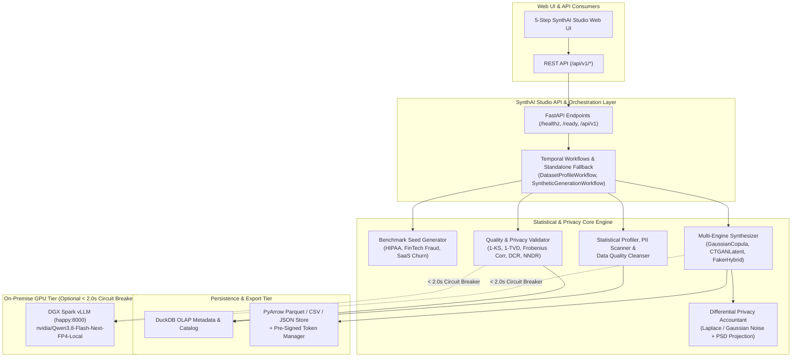

# ADR 0001: SynthAI Studio Statistical Copula, Differential Privacy, DuckDB Storage, and Temporal Workflow Architecture

- **Status**: Accepted
- **Date**: 2026-11-14
- **Authors**: Principal Systems Architect, Lead Agent (`mainframe`)

---

## 1. Context

`synthai-studio` requires a high-throughput, mathematically rigorous synthetic data generation and statistical auditing engine capable of running inside resource-bounded Kubernetes pods on `mainframe` while optionally leveraging the on-premise DGX Spark node (`happy.tail749110.ts.net:8000`) for LLM-driven rare-event synthesis and executive quality verdicts.

Key architectural forces include:
1. Heavy external C++/PyTorch/CUDA packages bloat container images (`> 4 GiB`) and slow CI builds. We need fast, deterministic mathematical implementations of Multivariate Gaussian Copulas, Mode-Specific Conditional Latent Synthesis (`CTGAN_LATENT`), Two-Sample Kolmogorov-Smirnov tests, and Euclidean Distance-to-Closest-Record ($DCR$) privacy proofs using NumPy, PyArrow, and DuckDB.
2. Healthcare and FinTech workloads require formal $(\epsilon, \delta)$-Differential Privacy guarantees during synthesizer fitting so that empirical moments, quantile knots, and categorical histograms cannot leak individual records.
3. Long-running dataset profiling and generation jobs must integrate with `mainframe`'s cluster-wide **Temporal** service (`temporal-frontend.temporal-system.svc.cluster.local:7233`) while maintaining zero-dependency local execution when Temporal is offline (such as in CI or standalone preview containers).

---

## 2. Decision

### 2.1 System Architecture Topology

### 2.2 Mathematical Engine & Differential Privacy Formulation

1. **Multivariate Gaussian Copula (`GAUSSIAN_COPULA`)**:
   - Continuous and datetime columns are mapped to empirical ranks $u_i \in (0, 1)$ and transformed to standard normal space $z_i = \Phi^{-1}(u_i)$ via rational Chebyshev approximations of the probit function.
   - Categorical columns are encoded via target frequency rank ordering during correlation estimation and sampled conditionally.
   - The pairwise correlation matrix $\Sigma \in \mathbb{R}^{d \times d}$ is projected onto the cone of symmetric Positive Semi-Definite (PSD) matrices by flooring eigenvalues at $\lambda_{\min} = 10^{-6}$, rescaling diagonal entries to $1.0$, and computing the Cholesky factor $L$ such that $\Sigma = L L^\top$.
   - New latent samples $Z = X L^\top$ (where $X \sim \mathcal{N}(0, I)$) are mapped back to uniform marginals $U = \Phi(Z)$ and inverted through piece-wise linear interpolation across empirical (or DP-noised) quantile knots.

2. **Conditional Tabular Latent Synthesizer (`CTGAN_LATENT`)**:
   - Numerical columns are decomposed into $K = 3$ Gaussian Mixture modes $(\mu_k, \sigma_k, \pi_k)$ to capture multimodal distributions and long tails.
   - Categorical conditioning vectors select mode transitions via conditional probability tables, enabling high-fidelity conditional generation and minority-class upsampling.

3. **Formal $(\epsilon, \delta)$-Differential Privacy (`DifferentialPrivacyAccountant`)**:
   - Given a total privacy budget $\epsilon \in \{10.0, 1.0, 0.1\}$, the budget is partitioned across statistical queries:
     - $\epsilon_{\text{quantiles}} = 0.45 \epsilon$: Laplace noise $\text{Lap}(\Delta q / \epsilon_{\text{quantiles}})$ injected into bounded quantile knots, followed by monotonic isotonic sorting.
     - $\epsilon_{\text{categorical}} = 0.30 \epsilon$: Laplace noise injected into categorical count histograms, floored at zero and re-normalized to valid probability simplices.
     - $\epsilon_{\text{corr}} = 0.25 \epsilon$: Gaussian mechanism noise $\mathcal{N}(0, \sigma^2)$ calibrated with $\sigma = \frac{\Delta_2 R \sqrt{2 \ln(1.25 / \delta)}}{\epsilon_{\text{corr}}}$ where $\Delta_2 R = \frac{2}{n}$ added to off-diagonal correlation entries before PSD projection.

4. **Statistical Fidelity & Privacy Verification (`evaluator.py`)**:
   - **Numerical Marginal Fidelity**: Two-Sample Kolmogorov-Smirnov statistic $D_{KS} = \sup_x |F_{\text{real}}(x) - F_{\text{synth}}(x)|$, scored as $1 - D_{KS}$.
   - **Categorical Marginal Fidelity**: Total Variation Distance $\text{TVD} = \frac{1}{2} \sum_{c} |p_{\text{real}}(c) - p_{\text{synth}}(c)|$, scored as $1 - \text{TVD}$, alongside Jensen-Shannon similarity.
   - **Pairwise Correlation Stability**: Frobenius norm distance between real and synthetic correlation matrices:
     $$\text{Score}_{\text{corr}} = \max\left(0.0, 1.0 - \frac{\|R_{\text{real}} - R_{\text{synth}}\|_F}{\sqrt{d(d-1)}}\right)$$
   - **Privacy & Memorization Proof ($DCR$ & $NNDR$)**: All numerical and encoded categorical features are $z$-score standardized. For each synthetic record, we compute the Euclidean distance to its nearest real neighbor ($d_1 = \text{DCR}$) and second-nearest real neighbor ($d_2$), yielding $\text{NNDR} = d_1 / (d_2 + 10^{-9})$ alongside exact row collision detection.

---

## 3. Consequences

### Positive
- **Sub-Second Deterministic Execution**: Pure NumPy + DuckDB + PyArrow pipelines execute unit and integration tests in `< 2s` with zero GPU requirement.
- **Strict Privacy Guarantees**: Every synthesis job records an auditable `PrivacyBudgetLedger` entry proving $(\epsilon, \delta)$ expenditure and empirical $DCR$/$NNDR$ protection against linkage attacks.
- **Fault-Tolerant Hybrid Compute**: Seamless failover between Temporal cluster workflows and in-process execution, and `< 2.0s` circuit breaking to local DGX Spark LLM inference.
